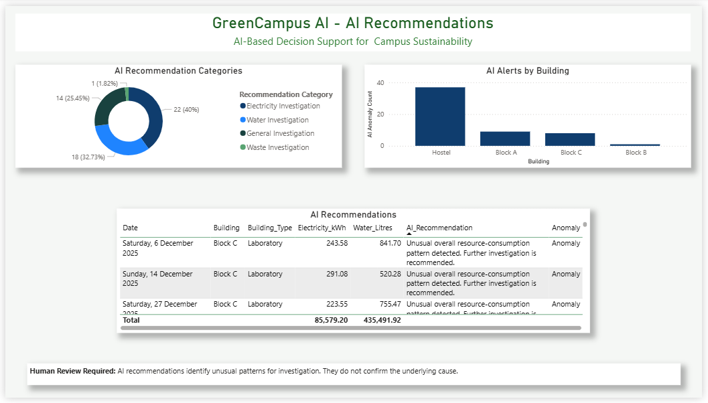

# 🌱 GreenCampus AI – AI-Powered Campus Sustainability Monitoring System

## Project Overview

GreenCampus AI is an AI-powered campus sustainability monitoring project developed as part of the IBM SkillsBuild internship.

The project focuses on using data analysis, artificial intelligence, and data visualization to support campus sustainability monitoring and help identify opportunities for improving resource management.

## Objectives

- Explore the role of AI in campus sustainability.
- Analyse sustainability-related data.
- Present important findings through interactive visualizations.
- Support data-driven sustainability decisions.

## Key Features

- Sustainability data analysis.
- Interactive Power BI dashboard.
- Visual representation of important project insights.
- AI-focused approach to campus sustainability monitoring.

## Technologies Used

- Power BI – Data visualization and dashboard development.
- Python / Jupyter Notebook – Data analysis and experimentation, if used in the project.
- IBM SkillsBuild – Internship learning platform.

## Project Structure

| Folder | Description |
|---|---|
| `dashboard` | Dashboard files |
| `data` | Project datasets |
| `documentation` | Project reports and documentation |
| `notebooks` | Jupyter notebooks |
| `project_demonstration` | Project demonstration files |

## Dashboard Preview

## Project Demonstration

[Watch GreenCampus AI Project Demo](https://www.youtube.com/watch?v=OYZ3x-Ix9RQ)

## Internship Information

**Program:** IBM SkillsBuild Internship  
**Project:** GreenCampus AI  
**Domain:** Artificial Intelligence and Sustainability

## Future Improvements

- Integrate additional campus sustainability datasets.
- Explore more AI-based analysis techniques.
- Improve dashboard insights and reporting.
- Explore real-time sustainability monitoring.

## Disclaimer

This project was developed for educational and internship purposes. The results and recommendations depend on the datasets and methods used in the project.
